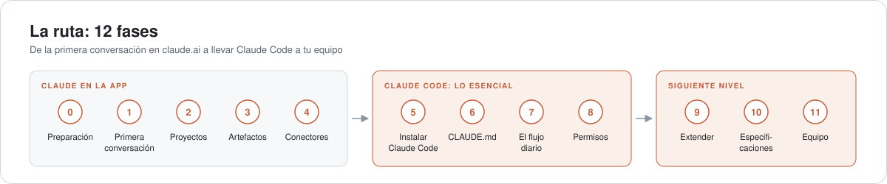
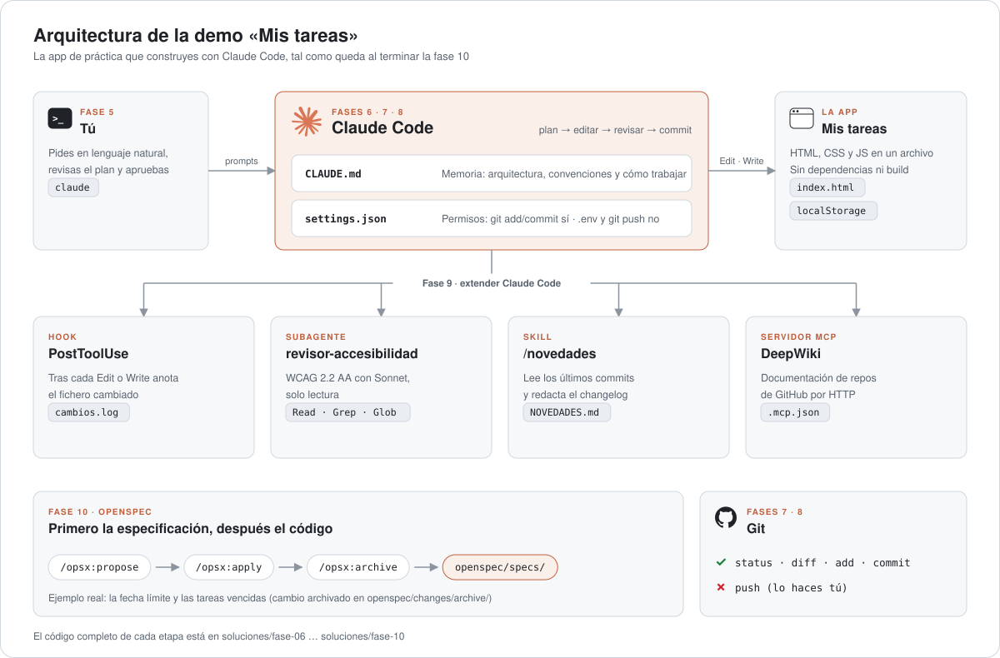

<div align="center">

<a href="https://antonioherrera.tech/guias/claude-desde-cero/">
  <picture>
    <source media="(prefers-color-scheme: dark)" srcset="docs/readme/logo-dark.svg">
    
  </picture>
</a>

**Aprende Claude y Claude Code en español, paso a paso y con capturas reales.**<br>
Empiezas en la app con tu primera conversación y terminas usando Claude Code en equipo.

[📖 Leer la guía](https://antonioherrera.tech/guias/claude-desde-cero/) ·
[Las 12 fases](#las-12-fases) ·
[La demo](#la-demo-mis-tareas) ·
[Qué hay aquí](#qué-hay-en-el-repositorio) ·
[Autor](#sobre-el-autor)


[](LICENSE)
[](LICENSE-docs.md)

</div>

---

## La guía

<a href="https://antonioherrera.tech/guias/claude-desde-cero/">
  
</a>

Este repositorio acompaña a la guía **[Claude desde cero](https://antonioherrera.tech/guias/claude-desde-cero/)**.
La guía explica cada paso con capturas. Aquí tienes lo que vas a copiar y pegar: chuletas, prompts, configuración de
Claude Code lista para usar y la app de práctica tal como queda al acabar cada fase.

- **Para quién:** cualquiera que quiera empezar con Claude. Las fases 0–4 no exigen saber programar.
- **Comprobada:** cada comando se ha ejecutado de verdad y se ha contrastado con la
  [documentación oficial](https://code.claude.com/docs/en/overview). Última revisión: 15 de octubre de 2026
  (Claude Code 2.1.300).
- **Independiente:** no es documentación oficial de Anthropic.

```bash
git clone https://github.com/tonyfht/claude-desde-cero.git
```

## Las 12 fases

<picture>
  <source media="(prefers-color-scheme: dark)" srcset="docs/readme/ruta-dark.svg">
  
</picture>

| | Fase | En la web | Chuleta |
|:-:|---|:-:|:-:|
| | **💬 Claude en la app** | | |
| 0 | Preparación | [Leer](https://antonioherrera.tech/guias/claude-desde-cero/fase-0-preparacion/) | [00](fases/00-preparacion.md) |
| 1 | Primera conversación | [Leer](https://antonioherrera.tech/guias/claude-desde-cero/fase-1-primera-conversacion/) | [01](fases/01-primera-conversacion.md) |
| 2 | Proyectos | [Leer](https://antonioherrera.tech/guias/claude-desde-cero/fase-2-proyectos/) | [02](fases/02-proyectos.md) |
| 3 | Artefactos | [Leer](https://antonioherrera.tech/guias/claude-desde-cero/fase-3-artefactos/) | [03](fases/03-artefactos.md) |
| 4 | Conectores | [Leer](https://antonioherrera.tech/guias/claude-desde-cero/fase-4-conectores/) | [04](fases/04-conectores.md) |
| | **⌨️ Claude Code: lo esencial** | | |
| 5 | Instalar Claude Code | [Leer](https://antonioherrera.tech/guias/claude-desde-cero/fase-5-instalar-claude-code/) | [05](fases/05-instalar-claude-code.md) |
| 6 | CLAUDE.md y contexto | [Leer](https://antonioherrera.tech/guias/claude-desde-cero/fase-6-claude-md/) | [06](fases/06-claude-md.md) |
| 7 | El flujo diario | [Leer](https://antonioherrera.tech/guias/claude-desde-cero/fase-7-flujo-diario/) | [07](fases/07-flujo-diario.md) |
| 8 | Permisos y seguridad | [Leer](https://antonioherrera.tech/guias/claude-desde-cero/fase-8-permisos/) | [08](fases/08-permisos.md) |
| | **🚀 Claude Code: siguiente nivel** | | |
| 9 | Extender: subagentes, hooks, skills y MCP | [Leer](https://antonioherrera.tech/guias/claude-desde-cero/fase-9-extender/) | [09](fases/09-extender.md) |
| 10 | Trabajar con especificaciones (OpenSpec) | [Leer](https://antonioherrera.tech/guias/claude-desde-cero/fase-10-especificaciones/) | [10](fases/10-especificaciones.md) |
| 11 | Llevarlo a un equipo | [Leer](https://antonioherrera.tech/guias/claude-desde-cero/fase-11-equipo/) | [11](fases/11-equipo.md) |

## La demo: «Mis tareas»

A partir de la fase 6 construyes con Claude Code una pequeña app de tareas. Es un único `index.html`, sin
dependencias, y sirve de excusa para aprender cada pieza de Claude Code sobre algo real. Así queda al terminar:

<picture>
  <source media="(prefers-color-scheme: dark)" srcset="docs/readme/arquitectura-dark.svg">
  
</picture>

| Etapa | Qué añade | Carpeta |
|---|---|---|
| Fase 6 | La app creada con Claude Code y su `CLAUDE.md` | [`soluciones/fase-06`](soluciones/fase-06/) |
| Fase 7 | Filtros Todas / Pendientes / Hechas | [`soluciones/fase-07`](soluciones/fase-07/) |
| Fase 8 | Permisos en `.claude/settings.json` y `.gitignore` | [`soluciones/fase-08`](soluciones/fase-08/) |
| Fase 9 | Servidor MCP, hook, subagente, skill y `NOVEDADES.md` | [`soluciones/fase-09`](soluciones/fase-09/) |
| Fase 10 | Fecha límite y tareas vencidas, especificadas con OpenSpec | [`soluciones/fase-10`](soluciones/fase-10/) |

> [!TIP]
> Las respuestas de Claude no son deterministas: tu app no será idéntica a la de `soluciones/`, y no pasa nada.
> Úsala para comparar o para continuar desde un punto conocido.

## Qué hay en el repositorio

| Carpeta | Contenido |
|---|---|
| 📋 [`fases/`](fases/) | La chuleta de cada fase: pasos, prompts y comandos listos para copiar |
| ✍️ [`prompts/`](prompts/) | El brief del caso práctico (fases 1–4) y la plantilla para pedir bien |
| ⚙️ [`ejemplos/`](ejemplos/) | Configuración de Claude Code lista para copiar: `CLAUDE.md`, `.claude/settings.json` (permisos y hook), un hook, un subagente, una skill y `.mcp.json` |
| ✅ [`soluciones/`](soluciones/) | La app *Mis tareas* tal como queda al terminar las fases 6, 7, 8, 9 y 10 |

**Cómo usarlo:** sigue la guía en la web, ten abierta la chuleta de la fase en la que estás y copia de `ejemplos/` y
`prompts/` lo que necesites. Si te pierdes construyendo la app, compara con `soluciones/`.

## Qué necesitas

- **Fases 0–4 (app):** una cuenta de Claude en [claude.ai](https://claude.ai). Basta con el plan gratuito para empezar.
- **Fases 5–11 (Claude Code):** un plan de pago (Pro, Max, Team o Enterprise) o una cuenta de Claude Console, y
  Windows, macOS o Linux. Las capturas de la guía están hechas en Windows con el plan Pro.

## Sobre el autor

<table>
<tr>
<td width="120" valign="top">
  <a href="https://antonioherrera.tech"></a>
</td>
<td valign="top">

**Antonio Herrera** · Fractional CTO y asesor tecnológico.<br>
Escribo guías prácticas sobre IA aplicada al desarrollo de software y las pruebo antes de publicarlas.

[](https://antonioherrera.tech)
[](https://antonioherrera.tech/guias/)
[](https://www.linkedin.com/in/antoniofranciscoherrera/)
[](https://www.linkedin.com/newsletters/6984444085109469184/)
[](https://github.com/tonyfht)

</td>
</tr>
</table>

¿Te ha servido? Dale una ⭐ al repositorio, compártelo o cuéntamelo en
[LinkedIn](https://www.linkedin.com/in/antoniofranciscoherrera/). Si encuentras un error o un comando que ha cambiado,
abre un [issue](https://github.com/tonyfht/claude-desde-cero/issues).

## Licencia

- Código y configuración: [MIT](LICENSE).
- Textos: [CC BY 4.0](LICENSE-docs.md).

---

<sub>Claude y Claude Code son marcas de Anthropic; esta guía no está afiliada a Anthropic. Los diagramas se generan con
`node docs/readme/build.mjs`; los logos de Claude y GitHub son de [Simple Icons](https://simpleicons.org) (CC0).</sub>
